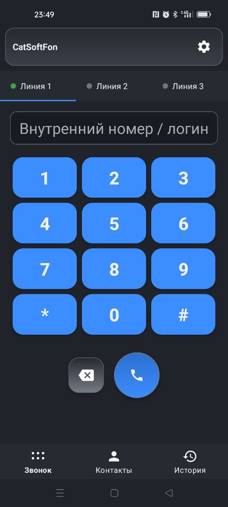
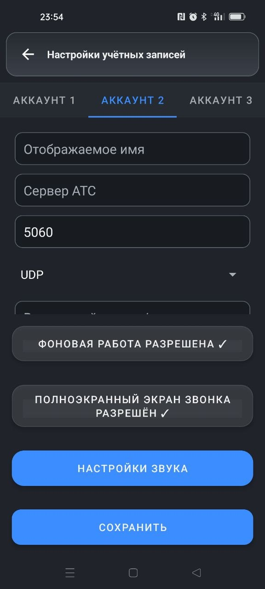
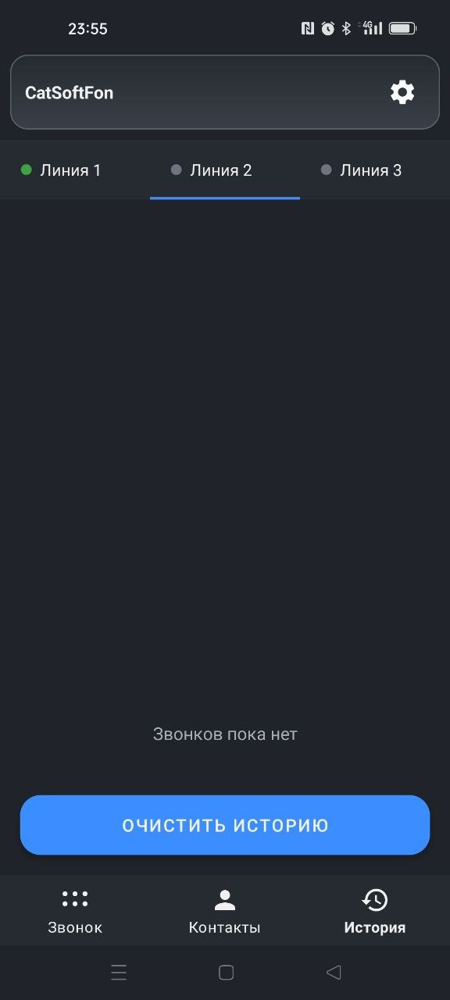

# CatSoftFon for Android

Android-клиент для той же любой SIP-АТС, что и Windows-версия CatSoftFon, построенный на
[Linphone SDK](https://www.linphone.org/en/technical/sdk) (та же библиотека, что использует
официальное приложение Linphone для Android).

  

## Функции

- Регистрация на SIP-АТС (UDP/TCP/TLS), звонки (входящие/исходящие), удержание, mute, DTMF
- Полноэкранный экран входящего звонка + уведомления (в т.ч. пока приложение в фоне)
- Локальная адресная книга с click-to-call
- История звонков (входящие/исходящие/пропущенные)
- Presence контактов — та же SIP dialog-event BLF-подписка (RFC 4235), что и на Windows,
  никаких настроек на стороне АТС не требует (см. ниже)
- Синхронизация каталога АТС (CSV или vCard по URL) — как на Windows
- Тёмное "3D"-оформление в том же стиле, что и Windows-клиент

Все данные (аккаунт, контакты, история) хранятся только локально, в приватном хранилище
приложения — ничего не шлётся куда-либо кроме вашей АТС и (если включена синхронизация
каталога) вашего URL каталога.

## Установка

- **RuStore** — поиск «CatSoftFon» (после прохождения модерации)
- **IzzyOnDroid** (F-Droid-совместимый репозиторий) — после включения в каталог
- **GitHub Releases** — [последний релиз](https://github.com/SDejaVu/CatSoftFon-android/releases/latest):
  `CatSoftFon-<версия>-universal.apk` подходит для любого устройства; отдельные APK под
  `arm64-v8a` / `armeabi-v7a` / `x86_64` / `x86` заметно меньше.

Все APK подписаны одним ключом. SHA-256 отпечаток сертификата для проверки
(`apksigner verify --print-certs`):

```
EA:19:6F:C1:74:52:3D:CA:DF:01:E6:35:DF:68:7A:7A:FE:5D:03:1F:25:A7:06:B5:85:F8:DE:C7:9F:6E:1C:BF
```

[Политика конфиденциальности](https://sdejavu.github.io/CatSoftFon-android/privacy.html)

## Как это устроено

Все вызовы Linphone SDK (создание `Core`, регистрация аккаунта через
`Factory.createAccountParams/createAccount`, звонки `inviteAddressWithParams`,
`acceptWithParams`, `pause/resume`, `sendDtmf`) сделаны по образцу официального клиента
[linphone-android](https://github.com/BelledonneCommunications/linphone-android).

### Presence

Первая версия этого экрана использовала `Friend`/`FriendList` — встроенный в Linphone SDK
стандартный SIP SIMPLE presence (RFC 3856, online/busy/dnd/offline, которые телефон публикует о
себе сам). На реальной АТС это оказалась не та подписка: Asterisk-хинты (BLF) публикуются только
через событие-пакет `dialog` (RFC 4235) — подтверждено captured-логами на Windows-клиенте — а
Friend API подписаться на `dialog` не умеет в принципе.

Поэтому presence здесь теперь устроено как на Windows: `PresenceManager` сам отправляет
`SUBSCRIBE` на событие-пакет `dialog` через низкоуровневый `Core.createSubscribe(address,
"dialog", expires)` (тот же универсальный API, которым сам SDK пользуется для своих служебных
подписок) и разбирает `dialog-info+xml` в NOTIFY ровно так же, как `PresenceService.cs`:
пустое тело/`terminated` → свободен, `confirmed` → разговор, `early` → звонит. Никаких
дополнительных настроек на АТС для этого не нужно — ни AMI, ни что-либо ещё.

## Сборка

1. Установите [Android Studio](https://developer.android.com/studio) (включает Android SDK) и
   запустите её хотя бы один раз, чтобы она докачала SDK.
2. Откройте папку `CatSoftFonAndroid` как проект — `gradlew`/`gradlew.bat` уже в репозитории,
   Android Studio сама скачает остальные зависимости (включая Linphone SDK с
   `download.linphone.org`, подключённого в `settings.gradle.kts`).
3. Run ▶ на реальном устройстве или эмуляторе (минимум Android 8.0 / API 26).

## Установочный файл (APK для раздачи)

В Android Studio: `Build → Generate Signed Bundle / APK…` → APK → создать или выбрать
keystore → Release. Либо — так же, как `installer/build-installer.ps1` у Windows-клиента —
одной командой из корня репозитория:

```
powershell -ExecutionPolicy Bypass -File installer\build-release-apk.ps1
```

При первом запуске скрипт сам создаст ключ подписи (`keytool`, спросит пароль и alias) и
файл `keystore.properties` (не коммитьте его — пароли внутри; шаблон без паролей —
`keystore.properties.example`), а дальше просто собирает `gradlew assembleRelease`. Готовые
файлы: `app/build/outputs/apk/release/app-*-release.apk` (universal + по одному на ABI). **Сохраните
получившийся `.keystore`-файл и пароли** — тот же ключ понадобится для подписи всех будущих
обновлений (иначе Android откажется ставить обновление поверх уже установленной копии).

### Структура

```
app/src/main/java/com/catsoftfon/sip/
├── CatSoftFonApplication.kt       — точка входа, связывает все сервисы
├── sip/SipManager.kt         — обёртка над Linphone Core (аналог Services/SipService.cs)
├── sip/CallForegroundService.kt, BootReceiver.kt
├── presence/PresenceManager.kt
├── data/JsonStore.kt, ContactRepository.kt, DirectoryImportService.kt
├── model/Contact.kt, CallHistoryEntry.kt, AppSettings.kt
└── ui/                       — Activity/Fragment экраны (Dialer, Контакты, История, Настройки)
```

## Permissions

Приложение попросит доступ к микрофону, уведомлениям (Android 13+) и Bluetooth-гарнитуре
(Android 12+) при первом запуске.

## Лицензия

[GNU AGPLv3](LICENSE). Приложение использует Linphone SDK (© Belledonne Communications,
AGPLv3).
